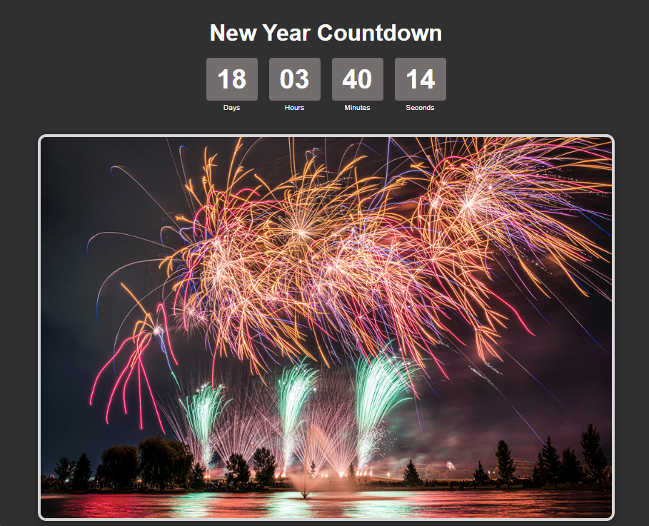

# Countdown Timer App

An Angular app that counts down to New Year's Day. The deadline comes from a small Express backend, and the display updates every second.



## Features

- Shows the days, hours, minutes and seconds left until the deadline.
- Updates in real time every second.
- Rolls over automatically: by default the deadline is always the next New Year's Day (midnight UTC).
- Optional fixed deadline through an environment variable.
- Responsive design for different screen sizes.

## Technologies Used

- **Angular 19**: frontend framework
- **RxJS**: reactive countdown stream
- **Express**: backend API
- **HTML5** and **CSS3**: structure and styling

## Getting Started

### Prerequisites

- [Node.js](https://nodejs.org/) 18.19 or later (required by Angular 19)

### 1. Clone the repository

```bash
git clone https://github.com/clw237/countdown-timer.git
cd countdown-timer
```

### 2. Start the Express backend

```bash
cd backend
npm install
npm start
```

The API runs at http://localhost:3000.

### 3. Start the Angular frontend

In a second terminal, from the repository root:

```bash
cd frontend
npm install
npm start
```

Open http://localhost:4200/. The page reloads whenever you change a source file.

## Configuration

The backend reads these optional environment variables:

| Variable | Default | Description |
|---|---|---|
| `DEADLINE` | next New Year's Day, 00:00 UTC | Fixed deadline as an ISO 8601 date, e.g. `2027-06-01T00:00:00Z` |
| `PORT` | `3000` | Port the API listens on |
| `CORS_ORIGIN` | `http://localhost:4200` | Origin allowed to call the API |

Example:

```bash
DEADLINE=2027-06-01T00:00:00Z npm start
```

## API

`GET /api/deadline` returns:

```json
{ "secondsLeft": 4387844, "deadline": "2027-01-01T00:00:00.000Z" }
```
